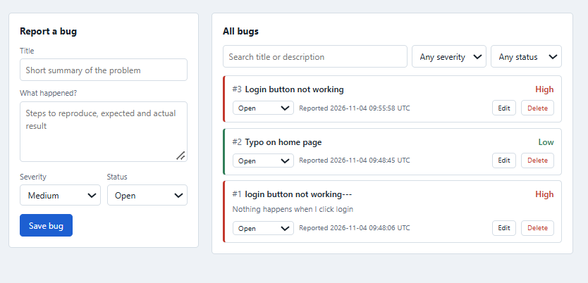

# Bug Tracker



A small full-stack web app for logging and tracking software bugs. Built with **Flask**, **SQLite**, and vanilla **HTML/CSS/JavaScript**, with a REST API and a pytest suite.

## Features
- Create, edit, delete bugs (title, description, severity, status)
- Filter by severity and status, and search by text
- Live counts of open, in-progress, and fixed bugs
- Input validation with clear error messages
- Request logging to `app.log`
- 15 automated API tests

## Tech stack
| Layer | Tools |
|---|---|
| Backend | Python, Flask |
| Database | SQLite (plain SQL, no ORM) |
| Frontend | HTML, CSS, JavaScript (`fetch`) |
| Testing | pytest |
| Version control | Git |

## Run it
```bash
git clone https://github.com/meghana-kolipaka/bug-tracker.git
cd bug-tracker
python -m venv venv
source venv/bin/activate        # Windows: venv\Scripts\activate
pip install -r requirements.txt
python app.py
```
Open http://127.0.0.1:5000

## Run the tests
```bash
python -m pytest -v
```

## API
| Method | Endpoint | Description |
|---|---|---|
| GET | `/api/bugs?severity=&status=&q=` | List bugs, newest first, with optional filters |
| GET | `/api/bugs/<id>` | Get one bug |
| POST | `/api/bugs` | Create a bug (`title` required) |
| PUT | `/api/bugs/<id>` | Update any of title, description, severity, status |
| DELETE | `/api/bugs/<id>` | Delete a bug |
| GET | `/api/stats` | Counts grouped by status and severity |

Example:
```bash
curl -X POST http://127.0.0.1:5000/api/bugs \
  -H "Content-Type: application/json" \
  -d '{"title": "Login fails on Safari", "severity": "High"}'
```

Status codes: `201` created, `204` deleted, `400` invalid input, `404` not found.

## Development process (SDLC)
1. **Requirements:** users can report, update, find, and close bugs.
2. **Design:** one `bugs` table; REST endpoints; a single-page UI that calls the API.
3. **Implementation:** data layer (`database.py`), routes and validation (`app.py`), UI (`templates/`, `static/`).
4. **Testing:** `tests/test_api.py` covers create, validation, filters, search, update, delete, and stats using a temporary database per test.
5. **Release:** v1.0 tagged on GitHub.

## Project structure
```
bug-tracker/
├── app.py            # Flask app, routes, validation, logging
├── database.py       # SQL queries (CRUD, filters, GROUP BY stats)
├── templates/index.html
├── static/style.css
├── static/script.js
├── tests/test_api.py
├── requirements.txt
└── README.md
```

## Possible next steps
- User login and bug assignment
- Pagination
- Switch SQLite to MySQL
